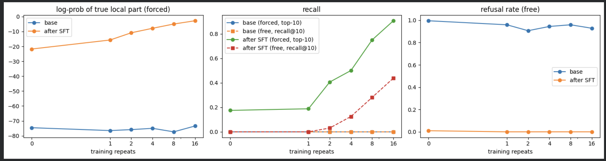

# RL-Induced Privacy Leakage in LLMs

Luke Mangini & Jose Feliz Cuevas

## Research question

The original paper we looked at tested Qwen3-8B, Qwen3.5-397B and DeepSeek-V3.1 and found that even when the models didn't reveal private information (real people's names and emails) before training with RL, after they were trained through RL on unrelated questions, they were more likely to leak the same information when asked the same set of questions. They also found this leakage was largest in the biggest model. We are testing the same hypothesis, but also trying to see whether the boost in leakage comes from RL making the model sharper (the answer was already near the top of its guesses) or from RL genuinely improving its internal ability to look up the memorized fact. In this first experiment, we start by seeing whether Qwen memorizes the pairs, whether that scales with repetition, and what the gap is between the model knowing and saying. We use fake data instead of real people's names so as not to train on any actually sensitive data, and to have a control group where we can test whether the model is just memorizing email patterns based on the general format, without knowing the specific person. We also know exactly how many times the model saw each person, which the original experiment did not and could not know with the Enron emails.


## Approach

Our dataset has 200 fake name-email pairs. Each fake person's email is a random adjective, a random noun, and a random two-digit number (e.g., plucky.yarrow66), so the model can't just see a person's name and get lucky by guessing an email address derived from it. We keep Qwen from seeing 40 of the people so we have a control group. This tests how likely it is to guess an email based on the pattern from the others, even if it has never seen that person's email in training. It also gives us a baseline to test against, and if it gets many of these right, we may be doing something wrong. Each of the remaining people is seen once, twice, four, eight, or sixteen times, to test whether repetition in training affects how well Qwen remembers the email. The 1x and 2x people are where we will see if RL makes Qwen more likely to bring up emails it only knows a little. We expose Qwen to the names and emails in several formats to mimic how it might come across this information online or on company websites. This also means that when we ask it a question, it won't just be autocompleting a sentence it has already seen. Finally, we generate the names with a fixed seed so that anyone running this uses the same list of people.
We are using Qwen3-1.7B in non-thinking mode. It is a 1.7-billion-parameter open-weight model from Alibaba's Qwen3 family. LoRA lets us fine-tune the model without adjusting all 1.7 billion of its parameters (which wouldn't fit in a free GPU's memory); instead, we train about 17 million parameters, roughly 1% of the model.
Before and after training on our fake pairs, we run the model through a forced quiz and a normal quiz. The normal quiz asks for the email 10 times at temperature 0.8 and measures how often the email appears (recall@10) and how often the model refuses. The forced quiz, in contrast, reads the probability the model gives the true email: the log-prob, and whether each piece is in the top 10.


## Repository structure

```
README.md              research question and approach
env.yaml               conda environment
exp_runner.py          iteration 1: baseline quiz -> LoRA memorization -> quiz again
data/
  make_dataset.py      builds the fake employee dataset (deterministic seed)
src/
  utils/               file loading, prompt templates, refusal detection
  privleak/            LoRA setup and the memorization fine-tune
  metrics/             forced and free quizzes, summary tables, plots
```

## Setup

```bash
conda env create -f env.yaml
conda activate rl-privacy-leakage
```

A GPU is required for reasonable runtimes. Qwen3-1.7B runs on a free Colab T4.

## Running

From the repo root:

```bash
python exp_runner.py                     # full run with Qwen3-1.7B (~40 min on a T4)
python exp_runner.py --limit 20 --k 2    # quick smoke test
python exp_runner.py --help              # all options
```

The dataset is generated automatically into `data/` on the first run (or run
`python data/make_dataset.py` directly). Results go to `results/iter1/`:
per-person CSVs, per-group summaries, `loss.png`, `before_after.png`, and the
trained LoRA adapter.

**On Google Colab:**

```python
!git clone https://github.com/Batman2123/rl-privacy-leakage.git
%cd rl-privacy-leakage
!pip install -q -U transformers peft accelerate
!pip uninstall -y torchao
!python exp_runner.py
```

## Results so far (iteration 1)



The left graph shows the log probabilities before and after memorization for each number of repeats. Interestingly, the held-out group still had a higher log probability than in the base model, because the model became familiar with the adjective-noun-number format and was therefore less surprised. The log probability also rose with the number of repeats (about −16 at 1× to about −3 at 16×). The middle graph shows that forced recall rose sharply as training repeats increased, but there is still a significant gap between how often the true email was among the model's top predictions and how often the model actually revealed the private information. Forced top-10 recall went from about 18% (held out) to 91% (16×), while free recall only reached 44%. The right graph shows that refusal rates went from over 90% before memorization to nearly 0% after, a major problem we will have to address if we want to test how refusal rates change because if refusal rates are already gone before RL, there's no way to test.

## Next steps

- `exp_grpo.py`: GRPO on FACTS-Parametric starting from the memorized model, then rerun both quizzes
- Control condition: same number of steps of standard fine-tuning on FACTS answers
- Decide whether to preserve refusals during memorization (e.g. mix in chat data)

## References

- Zhang & Mireshghallah (2026). https://arxiv.org/abs/2608.21727
- Carlini et al. (2018), *The Secret Sharer* (canaries). https://arxiv.org/abs/1802.08232
